<div align="center">

# 🛡️ EpistemeGraph

### Auditing LLM answers against a *measured* knowledge graph: geometric and textual claim evidence, a fully learned decision layer, and conformal guarantees

[](https://www.python.org/)
[](https://www.anthropic.com/)
[](https://neo4j.com/cloud/aura/)
[](https://fastapi.tiangolo.com/)
[](https://scikit-learn.org/)
[](https://pytorch.org/)
[](https://huggingface.co/cross-encoder/nli-deberta-v3-xsmall)
[](web/)

**Author:** Anurag Raj ([@Virtuoso-8051](https://github.com/Virtuoso-8051)) · Department of Computer Science and Engineering, IIT Ropar

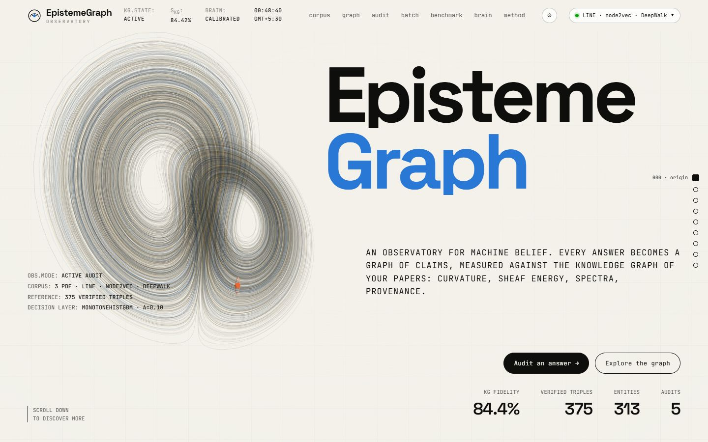

</div>

> **In one paragraph.** An LLM answers a question about your research papers. EpistemeGraph turns those papers into a
> **knowledge graph whose own accuracy is measured**, turns the answer into a **graph of claims**, and checks every claim
> with **natural-language inference against the source sentences** and with **graph geometry** (sheaf energy, Ricci
> curvature, Laplacian spectra). A **ten-model tournament** learns how to combine the evidence, and **conformal
> prediction** turns the result into `VERIFIED`, `ABSTAIN` or `HALLUCINATED` with a stated error rate. No weight or
> threshold is set by hand. The complete 400-question study cost **$1.90** in API calls.

---

## Contents

1. [Why this project exists](#1-why-this-project-exists)
2. [What it tells you about every answer](#2-what-it-tells-you-about-every-answer)
3. [Results at a glance](#3-results-at-a-glance)
4. [Quick start (terminal only)](#4-quick-start-terminal-only)
5. [Using the website](#5-using-the-website)
6. [System architecture](#6-system-architecture)
7. [The mathematics, phase by phase](#7-the-mathematics-phase-by-phase)
8. [How the benchmark and its gold answers are made](#8-how-the-benchmark-and-its-gold-answers-are-made)
9. [Detailed results](#9-detailed-results)
10. [Reading the numbers honestly](#10-reading-the-numbers-honestly)
11. [How the project evolved (v1 → v4)](#11-how-the-project-evolved-v1--v4)
12. [What is new, and what is not](#12-what-is-new-and-what-is-not)
13. [Scripts reference](#13-scripts-reference)
14. [Data, artefacts and the paper](#14-data-artefacts-and-the-paper)
15. [Repository layout](#15-repository-layout)
16. [Engineering, cost and reliability](#16-engineering-cost-and-reliability)
17. [Housekeeping: what can be deleted](#17-housekeeping-what-can-be-deleted)
18. [Limitations](#18-limitations)
19. [Citation](#19-citation)

---

## 1. Why this project exists

LLMs answer questions about specialised literature **fluently and confidently even when they are wrong**. They
misattribute a result from one paper to another, invent a dataset or a complexity bound, or go along with a false
premise. Three facts make this hard to catch:

1. **The model's own confidence is a weak signal.** On our benchmark, Claude Haiku 5.5's verbalised confidence ranks
   its own answers with AUROC **0.591**, barely better than a coin. On unanswerable and cross-paper questions it is
   *inversely* related to correctness (AUROC 0.341 and 0.219): the model is most confident precisely when it invents.
2. **Text similarity is not support.** "node2vec optimises a genetic fitness function" shares many words with the
   node2vec paper and is still false. Checkers that only compare text with text cannot separate *using* the corpus
   vocabulary from being *supported* by the corpus.
3. **The reference itself is fallible.** A knowledge graph built from PDFs by an LLM contains extraction errors. Most
   systems assume their reference graph is perfect; this one **measures** it.

EpistemeGraph answers five research questions: **(Q1)** how accurate is an LLM-built reference graph, measured rather
than assumed? **(Q2)** which quantities expose an unsupported claim beyond counting missing edges? **(Q3)** how do many
signals become a decision without hand-tuned weights, with a stated error rate? **(Q4)** can the system say *which*
claim is wrong when it is only told whether a whole answer is wrong? **(Q5)** how reliable are the labels, and therefore
what accuracy is attainable at all?

## 2. What it tells you about every answer

| Question | Output |
|---|---|
| **Is it hallucinated?** | `VERIFIED` / `ABSTAIN` / `HALLUCINATED`, from Mondrian cross-conformal prediction (per-class error control) |
| **How likely?** | a calibrated probability $`P(\text{hallucination}) = 1-S_{\text{final}}`$ |
| **How much?** | the share of asserted claims with no grounded support in the papers |
| **Which claim?** | a per-claim $`P(\text{unsupported})`$ from a multiple-instance network trained on answer labels only |
| **Why?** | 13 answer features + a 15-D vector per claim, with the verbatim source quote and NLI verdict for every claim |


## 3. Results at a glance

**Setup.** Corpus: **DeepWalk, LINE, node2vec** (3 papers, 76 chunks, 375 verified triples). **400** generated,
evidence-validated questions (120 factual, 40 cross-paper, 80 unanswerable, 160 false-premise). Audited model:
**Claude Haiku 5.5**, closed-book. Primary judge: **Claude Sonnet 5.5** with the gold evidence; Claude Haiku 5.5 as a
second judge on a fixed stratified sample of 100. Target: *the answer is fully supported* (78 of 400).

**Primary evaluation: 5×5 repeated stratified cross-validation over all 400 answers.**

| Detector | AUROC | 95% CI | ECE | DeLong p vs EpistemeGraph |
|---|---|---|---|---|
| **EpistemeGraph v4** (13 answer features + pooled claim evidence) | **0.742** ± 0.052 | [0.633, 0.780] | 0.090 | – |
| same learner, 13 answer-level features only | 0.737 | [0.659, 0.792] | 0.079 | 0.59 |
| text-only NLI checker (same pooled claim evidence) | 0.705 | [0.640, 0.776] | 0.027 | 0.88 |
| answer length (confound baseline) | 0.628 | [0.551, 0.702] | 0.042 | **0.049** |
| the audited model's own confidence | 0.591 | [0.504, 0.677] | 0.342 | **0.022** |

<p align="center">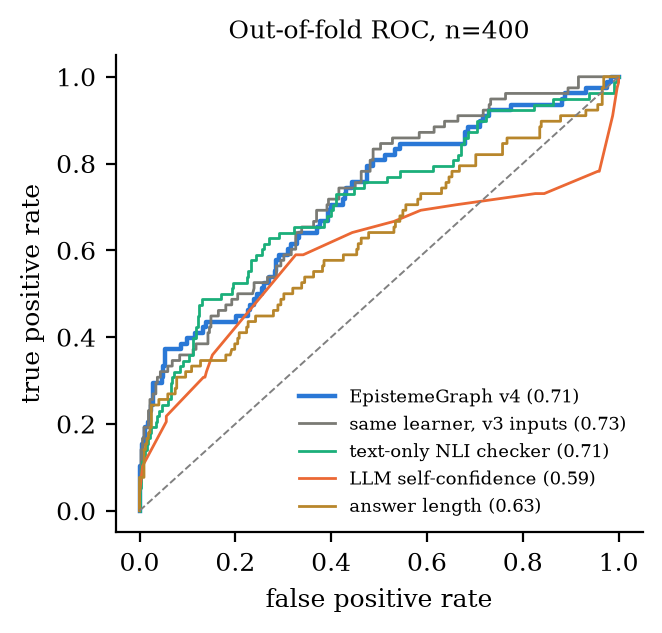</p>

| How many answers match the judge? (out-of-fold, all 400) | |
|---|---|
| Detector agrees with the judge | **330 / 400 (82.5%)** |
| Always answering "hallucinated" | 322 / 400 (80.5%) |
| Two Claude judges (Sonnet, Haiku) agree with *each other* (all 400) | **87.3%** (κ = 0.57) |
| On the 349 answers where both Claude judges agree: detector matches | **305 / 349 (87.4%)**, AUROC **0.762** |
| Balanced accuracy | 62.9% |
| Committed conformal decisions that are correct (α = 0.10) | **114 / 137 (83.2%)** |

> **The detector already agrees with the judge as often as two strong judges agree with each other.** That is the
> ceiling for raw agreement with these labels. [Section 10](#10-reading-the-numbers-honestly) explains why "97 out of
> 100" in the very first version was not a real result, and what would genuinely raise this number.

**Reference graph.** Intrinsic fidelity $`S_{\mathrm{KG}} = 84.4\%`$; measured precision on 100 random triples:
**53.0% strict** [43.3, 62.5] and **85.0% lenient** [76.7, 90.7]. Only 15 triples were wrong; 32 had the right
entities with an imprecise relation label.

**Decisions with a guarantee.** At α = 0.10, cross-conformal coverage is **94.2%** (target ≥ 90%); the system
abstains on 65.8% of answers and is **83.0%** accurate on the rest.

## 4. Quick start (terminal only)

The project runs locally: one Python process serves the website and the API on your machine. No hosting is needed.

```powershell
git clone https://github.com/Virtuoso-8051/EpistemeGraph.git
cd EpistemeGraph
python -m venv venv
.\venv\Scripts\Activate.ps1          # macOS/Linux: source venv/bin/activate
pip install -r requirements.txt
copy .env.example .env               # macOS/Linux: cp .env.example .env
```

Open `.env` and paste your Claude API key (create one at console.anthropic.com → *Get API key*). That is the only
value you must fill in:

```dotenv
ANTHROPIC_API_KEY=sk-ant-...           # the only value you must fill in
LLM_PROVIDER=anthropic
LLM_MODEL=claude-haiku-5-5             # the model UNDER AUDIT
EXTRACTOR_MODEL=claude-haiku-5-5       # answer -> claim graph
KG_MODEL=claude-haiku-5-5              # PDF chunk -> triples
JUDGE_MODEL=claude-sonnet-5-5          # benchmark labels (the judge sees the gold evidence)
GENERATOR_MODEL=claude-haiku-5-5       # benchmark questions
EPISTEME_BUDGET_USD=4.5                # hard spending cap across all runs
NEO4J_URI=                             # optional; a local mirror of the graph is always kept
```

Start it:

```powershell
python app.py          # Windows: or just double-click start.bat
```

The browser opens **http://localhost:8000** by itself as soon as the server is ready (API docs at `/docs`). Keep the
terminal open while you use the site; Ctrl+C stops it. Every start opens the **reference corpus** (the three papers)
with all its cached results, including the trained brain and earlier audits.

## 5. Using the website

| Section | What it does |
|---|---|
| **Entrance** | a preloader driven by the real loading steps, then a portal that opens into the page |
| **000 Origin · Premise · Signals** | a GPU strange attractor (Lorenz → Aizawa → Halvorsen) that morphs as you scroll; three interactive ridge fields for sheaf energy, curvature shift and spectral divergence |
| **001 Corpus** | drop PDFs: **New corpus** builds a fresh graph in its own Neo4j namespace; $`S_{\mathrm{KG}}`$, its four pillars and the measured precision |
| **002 Graph** | the 3D knowledge graph pinned on screen while five chapters scroll past (corpus, hubs, bridges, evidence, explore); the camera flies to each entity; click any node for its evidence quotes |
| **003 Audit** | ask anything: verdict, probability, unsupported share, claim graph, and a claim ledger with source quotes; every audit is saved in the History panel |
| **004 Batch** | a `.txt` file with one question per line, audited in the background |
| **005 Benchmark** | questions, run status, **how many answers match the judge**, ROC, reliability, per-category results and a per-answer table with out-of-fold scores |
| **006 Brain** | tournament, learned weights, pool, conformal quantiles, ablations, importance |
| **007 Method** | every formula (KaTeX) and a one-click **Overleaf bundle** |

| | |
|---|---|
| 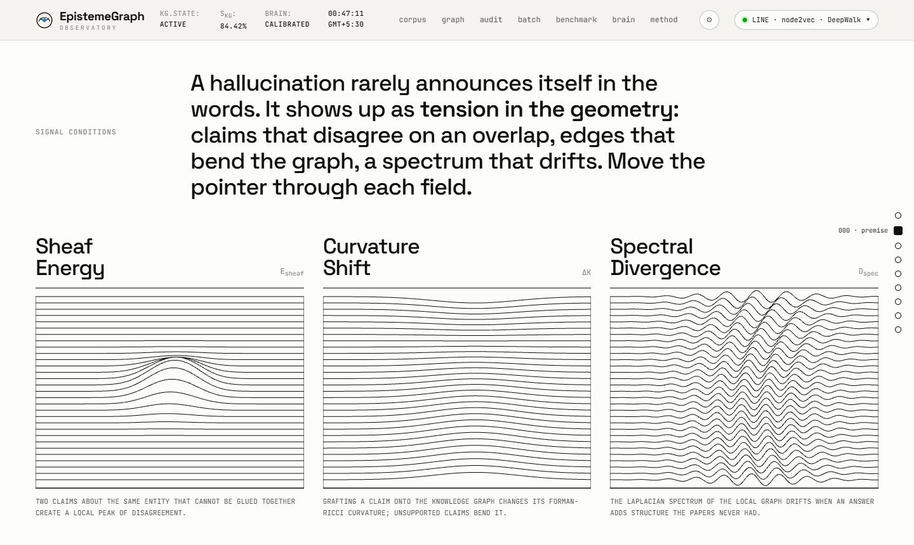 | 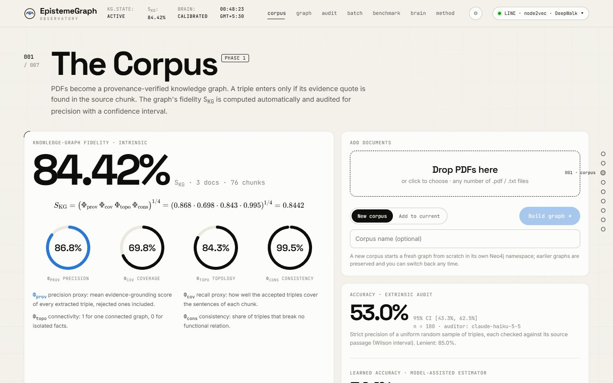 |
| 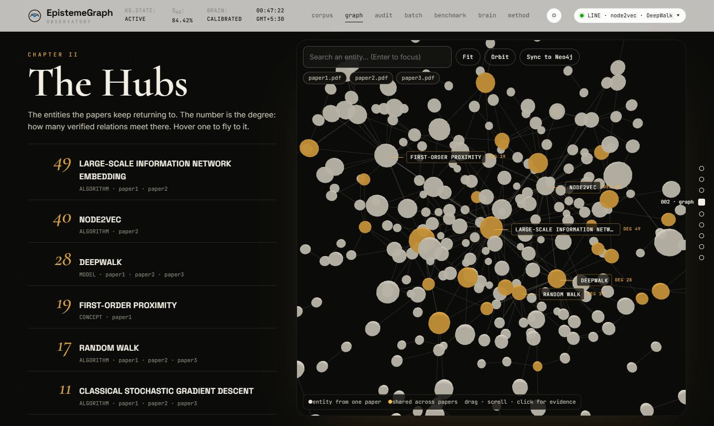 | 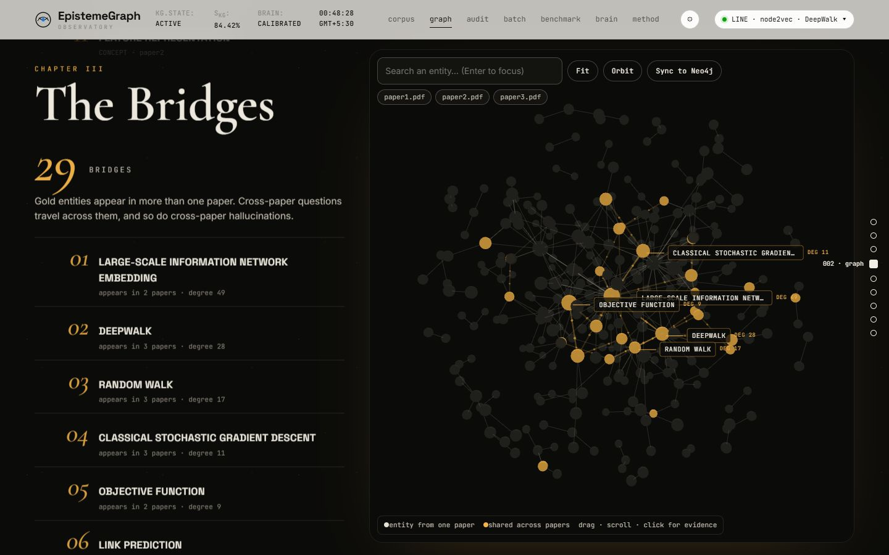 |
|  |  |
| 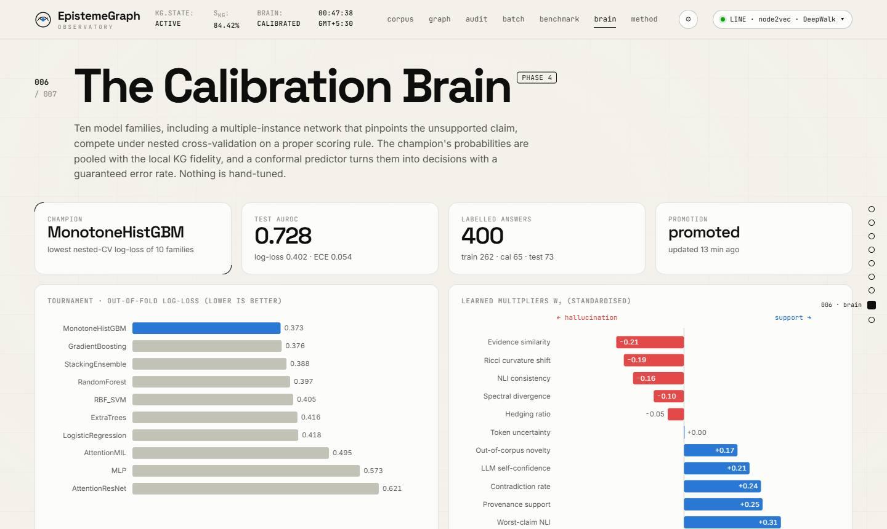 | 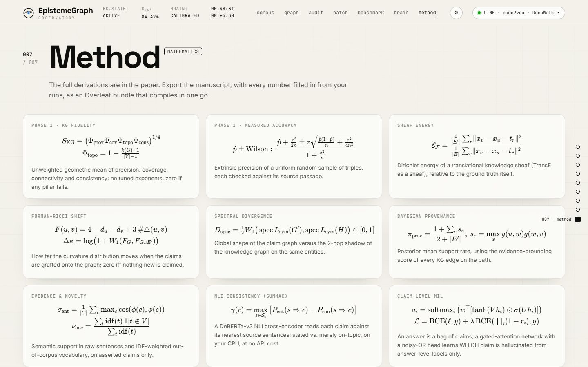 |

**For a visitor who brings their own PDFs (e.g. a professor).** Drop the PDFs on *001 Corpus* with **New corpus**
selected. A separate graph is built (about $0.05 for three papers), it becomes the active corpus, and audits on it work
immediately because the trained brain is transferred (marked *transferred*: the conformal guarantee is only certified
on the corpus it was calibrated on). The **reference corpus is protected**: the website cannot add documents to it,
rebuild it, re-run or re-train its benchmark, or re-audit it, so the published results cannot be overwritten by
accident. Switch corpora with the selector at the top right; the next server start opens the reference corpus again.
Set `EPISTEME_PROTECTED_WORKSPACES=` (empty) in `.env` to lift the protection; terminal scripts are never restricted.

## 6. System architecture

```text
 PHASE 1  PDFs ──► sentence-aligned chunks ──► LLM extraction (cached per chunk)
                     │
                     ▼
          quote verification: a triple is kept only if its evidence sentence is in the chunk
          and both entities occur in it  ──►  entity resolution against the existing graph
                     │
                     ▼
          Neo4j (namespaced per corpus) + local mirror ──► S_KG (4 pillars) + measured precision (audit)

 PHASE 2  question ──► audited LLM answers + states its confidence
                     └► SEPARATE call: answer ──► claim graph G' (asserted / speculative / refuted)

 PHASE 3  G' aligned to the KG subgraph G of its entities
          answer vector  x ∈ R^13 : sheaf energy, curvature shift, spectral divergence, provenance,
                                    evidence similarity, NLI mean / worst, novelty, contradictions,
                                    alignment, LLM confidence, token NLL, hedging
          claim vectors  z_i ∈ R^15 : provenance, support tier, conflict, polarity, alignment,
                                    NLI entail / contradict / consistency, similarity, novelty,
                                    sheaf residual, grafted-edge curvature
          claim-set pooling ψ(Z) = [mean, min, max] ∈ R^45   ──►   model input ∈ R^58

 PHASE 4  10-model nested-CV tournament (log-loss) ──► champion, cross-fitted on train+calibration
          ──► Platt scaling: S_query ──► reliability pool with S_KG(q) (kept only if it passes an LRT
          AND lowers cross-validated log-loss): S_final ──► Mondrian cross-conformal set
          ──► VERIFIED / ABSTAIN / HALLUCINATED  (+ per-claim scores from the multiple-instance network)
```

## 7. The mathematics, phase by phase

### 7.1 Phase 1: a measured reference graph

Four pillars in $`[0,1]`$, computed over all extracted triples $`\mathcal C`$, accepted triples $`\mathcal C^+`$, the graph
$`G=(V,E)`$ and the chunks $`\mathcal K`$:

```math
\Phi_{\text{prov}}=\frac1{|\mathcal C|}\sum_{c\in\mathcal C}g_c,\qquad
\Phi_{\text{cov}}=\frac{\sum_k w_k\,\mathrm{cov}(k)}{\sum_k w_k},\qquad
\Phi_{\text{topo}}=1-\frac{\kappa(G)-1}{|V|-1},\qquad
\Phi_{\text{cons}}=1-\frac{\#\text{functional violations}}{|\mathcal C^+|},
```


where $`g_c`$ is a triple's grounding score, $`w_k=\log(1+|k|)`$, $`\mathrm{cov}(k)`$ is how well a chunk's sentences are
covered by its triples, and $`\kappa(G)`$ counts connected components. They are combined as

```math
S_{\mathrm{KG}}=\big(\Phi_{\text{prov}}\,\Phi_{\text{cov}}\,\Phi_{\text{topo}}\,\Phi_{\text{cons}}\big)^{1/4}.
```


**Why the exponent 1/4 is derived, not tuned.** We require *symmetry* (no pillar privileged), *homogeneity* and a
*veto* (a failed pillar cannot be compensated). Among power means $`M_p=\big(\tfrac14\sum_j\Phi_j^p\big)^{1/p}`$, any
$`p>0`$ fails the veto because $`M_p\ge(\tfrac14\Phi_j^p)^{1/p}>0`$ whenever one pillar is positive. Every $`p\le0`$ vetoes,
and $`M_p`$ is non-decreasing in $`p`$ (power-mean inequality), so the **geometric mean $`M_0`$ is the least pessimistic
aggregator that still vetoes**. The *weights* cannot be learned: $`S_{\mathrm{KG}}`$ is one number per corpus, so with one
corpus they are unidentifiable.

**What can be measured is precision.** A uniform random sample of accepted triples is checked against its source
passages, which gives a Wilson interval

```math
\mathrm{CI}_{95}=\frac{\hat p+\frac{z^2}{2n}\pm z\sqrt{\frac{\hat p(1-\hat p)}{n}+\frac{z^2}{4n^2}}}{1+\frac{z^2}{n}},
```


and a logistic model of correctness from each triple's evidence signals turns all $`N`$ triples into the
model-assisted (difference) estimator of survey sampling,
$`\hat p_{\mathrm{MA}}=\frac1N\sum_t\hat m(\boldsymbol v_t)+\frac1n\sum_{t\in s}(y_t-\hat m^{(-t)}(\boldsymbol v_t))`$, which is
design-unbiased whatever the model. Every other Phase-1 constant (quote-match ratio, entity support, coverage
normaliser, extractor confidence, merge cosine) is perturbed one at a time on the cached extractions: $`S_{\mathrm{KG}}`$
moves by at most **0.034**.

### 7.2 Phase 2: decoupled interception

The audited model answers exactly as in production and states a confidence. A **separate** call extracts the claim
graph $`G'`$ with a polarity on every edge. If one call both answered and listed its claims, the model would decide which
of its statements get audited. The extraction prompt uses the live KG's relation vocabulary and its nearest entities as
naming hints, and every call is cached by a hash of prompt version, model and input.

### 7.3 Phase 3: the evidence

Let $`E'_+`$ be the asserted and speculative claim edges, $`G`$ the retrieved KG subgraph and $`x_v`$ unit embeddings.

* **Sheaf energy.** On a translational knowledge sheaf (identity restriction maps, relation shift $`t_r`$) the coboundary
  of $`e=(u\xrightarrow{r}v)`$ is $`(\delta x)_e=x_v-x_u-t_r`$; TransE is exactly the model that makes this energy small on
  true triples. The feature is the claim edges' mean energy relative to the KG's own,
  $`\mathcal E_{\mathcal F}=\overline{\|\delta x\|^2}_{E'_+}\big/\overline{\|\delta x\|^2}_{E}`$; each claim keeps its own residual.
* **Forman–Ricci curvature shift.** With $`F(u,v)=4-d_u-d_v+3|\triangle(u,v)|`$, grafting the claims onto the KG moves
  the curvature distribution by $`\Delta\kappa=\log\big(1+W_1(\mu_G,\mu_{G\cup E'_+})\big)`$.
  *Proposition:* $`\Delta\kappa\ge0`$, and $`\Delta\kappa=0`$ whenever $`E'_+\subseteq E`$ (an answer that adds nothing new
  distorts nothing). Each claim keeps the curvature of its grafted edge.
* **Spectral divergence.** $`D_{\text{spec}}=\tfrac12W_1\big(\mathrm{spec}\,L_{\text{sym}}(G'_+),\mathrm{spec}\,L_{\text{sym}}(H)\big)`$
  against the KG's 2-hop shadow $`H`$. *Lemma:* $`D_{\text{spec}}\in[0,1]`$ (the spectrum lies in $`[0,2]`$), and it is 0 for
  isomorphic graphs.
* **Provenance** $`\pi_{\text{prov}}=(1+\sum_e s_e)/(2+|E'_+|)`$, the Beta posterior of support along direct or two-hop
  grounded paths.
* **NLI consistency** (SummaC-ZS, DeBERTa-v3): $`\gamma(c)=\max_{s}\,[P_{\text{ent}}(s\Rightarrow c)-P_{\text{con}}(s\Rightarrow c)]`$
  over each claim's three nearest corpus sentences; mean $`\bar\gamma`$ and worst claim $`\gamma^{\min}`$.
* **Novelty** $`\nu_{\text{ooc}}`$ (IDF-weighted out-of-corpus vocabulary), **contradictions** $`\kappa_{\text{con}}`$,
  **alignment** $`\rho_{\text{align}}`$, **LLM confidence** $`c_{\text{LLM}}`$, **token NLL** (0 when the API hides
  log-probabilities, as Claude's does), **hedging** $`h_{\text{spec}}`$.

**Claim-set representation.** Each answer is a bag $`Z=\{\boldsymbol z_i\}`$ of 15-D claim vectors, summarised by
$`\psi(Z)=[\mathrm{mean}_i\boldsymbol z_i,\min_i\boldsymbol z_i,\max_i\boldsymbol z_i]\in\mathbb R^{45}`$ (fixed-pooling Deep Sets), so every learner
sees $13+45=58$ inputs. *Proposition:* if an answer is supported iff every claim's score exceeds $`t`$, the label is
$`\mathbb 1[\min_i u(\boldsymbol z_i)>t]`$, a threshold on one coordinate of $`\psi(Z)`$, whereas no function of the mean alone can
express it (the bags $`\{t+1,t+1\}`$ and $`\{t-1,t+3\}`$ have equal means and opposite labels).

### 7.4 Phase 4: learned, cross-fitted decisions

* **Tournament.** Ten families (logistic regression, monotone gradient boosting, random forest, extra trees, gradient
  boosting, RBF-SVM, MLP, stacking, a feature-attention ResNet and a gated-attention multiple-instance network with a
  noisy-OR claim head $`P(\text{supported})=\prod_i(1-r_i)`$). Hyper-parameters are tuned by inner 3-fold CV and the
  families compared by outer 5-fold CV on **log-loss**, a strictly proper scoring rule. The multiple-instance network is
  always kept as the **claim localiser**: its $`r_i`$ is a claim-level hallucination score learned without claim labels.
* **Cross-fitting.** The champion is re-fitted in 5 folds over train + calibration; its out-of-fold logits on all 327
  non-test answers feed Platt scaling, the pool and the conformal quantiles.
* **Reliability pool.** $`\operatorname{logit}S_{\text{final}}=b_0+b_1\operatorname{logit}S_{\text{query}}+b_2\operatorname{logit}S_{\mathrm{KG}}(q)`$.
  The old fixed rule $0.2\,S_{\mathrm{KG}}+0.8\,S_{\text{query}}$ became the special case $`b_0=0,b_1=\eta,b_2=1-\eta`$ of
  a *learned* pool. The KG term is kept only if a likelihood-ratio test rejects $`b_2=0`$ **and** it lowers
  cross-validated log-loss. If $`S_{\mathrm{KG}}(q)`$ were constant, $`b_2`$ would be unidentifiable, which is why the
  *per-question* local fidelity is pooled.
* **Mondrian cross-conformal decision.** With non-conformity $1-\hat p_y$ per class and $`q_c`$ the
  $`\lceil(n_c+1)(1-\alpha)\rceil`$-th smallest out-of-fold score, $`\Gamma(x)=\{c:1-\hat p_c(x)\le q_c\}`$. A single class is
  committed only if it is also the more probable class; otherwise the set becomes $`\{0,1\}`$ = `ABSTAIN`. Enlarging a
  set can only raise coverage, so the per-class guarantee $`P(y\in\Gamma\mid y=c)\ge1-\alpha`$ is kept, and a verdict never
  contradicts the probability shown next to it. The only knob is the risk level α (`EPISTEME_ALPHA`, default 0.10).

## 8. How the benchmark and its gold answers are made

1. `pypdf` extracts the text of each PDF, which is split into sentence-aligned chunks.
2. For each chunk, an LLM writes questions of one category **together with** the gold reference: the answer (factual,
   cross-paper), the false premise and its correction (false-premise), or why the papers cannot answer it
   (unanswerable), plus a **verbatim evidence sentence**.
3. An item is kept only if that evidence sentence is actually found in the chunk (fuzzy match ≥ 0.85). Near-duplicates
   are removed and papers are balanced per category.
4. The audited model answers each question **closed-book**, as a user would ask it.
5. A judge sees the question, its type, the gold reference, the gold chunk, six retrieved passages and the answer, and
   returns `SUPPORTED`, `PARTIALLY_SUPPORTED` or `UNSUPPORTED`. An answer counts as supported only if *every* claim is
   (the RAGTruth convention).

The gold answers therefore come from the papers themselves, through a verified quote, never from the model under audit.

## 9. Detailed results

### 9.1 The reference graph

| | value |
|---|---|
| Chunks / extracted triples / verified triples | 76 / 613 / 375 |
| Canonical entities (shared across papers) | 313 (29) |
| $`\Phi_{\text{prov}}`$ / $`\Phi_{\text{cov}}`$ / $`\Phi_{\text{topo}}`$ / $`\Phi_{\text{cons}}`$ | 86.8% / 69.8% / 84.3% / 99.5% |
| **$`S_{\mathrm{KG}}`$** | **84.4%** |
| Measured precision, strict (100 random triples) | **53.0%** [43.3, 62.5] |
| Measured precision, lenient | **85.0%** [76.7, 90.7] |
| Correct / partially correct / incorrect | 53 / 32 / 15 |
| By paper (strict / lenient) | paper1 46% / 82% · paper2 61% / 88% · paper3 54% / 86% |

Most "partially correct" triples have the right entities with an imprecise relation label, for example `BASED_ON`
where the passage says "uses", or "LINE" where the passage means LINE(1st). $`S_{\mathrm{KG}}`$ is an *index*, not a
precision, which is why both are reported. The auditor (Claude Haiku 5.5) belongs to the same family as the extractor,
so human confirmation is recommended.

### 9.2 Labels

| Category | n | Supported | Partially | Unsupported |
|---|---|---|---|---|
| Factual | 120 | 18 | 87 | 15 |
| Cross-paper | 40 | 8 | 28 | 4 |
| Unanswerable | 80 | 18 | 37 | 25 |
| False premise | 160 | 34 | 70 | 56 |
| **All (Sonnet 5.5 judge)** | **400** | **78 (19.5%)** | **222** | **100** |

* **Inter-judge agreement, all 400 answers** (Sonnet vs Haiku): 87.3% raw, κ = **0.57** ("moderate").
* **On the stratified 100-answer sample** (which deliberately over-represents the hard categories): 80% raw,
  κ = 0.35 (supported vs rest); κ = 0.48 for unsupported vs rest; ordinal weighted κ = 0.41.
* **Third judge from another family** (Gemini Pro, high reasoning, given the three PDFs, blind to the other verdicts,
  same 100 answers): it calls **70%** supported versus ~20% for the Claude judges, κ = **0.17** with Sonnet. All three
  judges agree on only 32 of 100. "Is a mostly correct answer with one wrong detail *supported*?" is a matter of
  definition: the Claude judges say no, Gemini usually says yes.

**Robustness to the choice of judge**

| Labels used for scoring | n | EpistemeGraph AUROC | Model's own confidence |
|---|---|---|---|
| Primary judge (Sonnet 5.5), 5×5 CV | 400 | 0.742 | 0.591 |
| Both Claude judges agree (consensus) | 349 | **0.762** | 0.571 |
| Majority of three judges | 100 | **0.727** | 0.650 |
| Gemini alone (lenient definition) | 100 | 0.486 | 0.714 |

The detector learned the strict "every claim supported" definition; against a judge that applies a lenient definition it
is at chance, while the model's confidence (which tracks overall correctness) does better. This is reported as is.
* **Verbosity confound:** answer length alone predicts the label with AUROC 0.604 (partially supported answers average
  822 characters, supported ones 648).
* The model accepted the false premise in **38.8%** of false-premise answers.
* Some generated items have a wrong gold label (e.g. an "unanswerable" question whose answer is in a figure caption).

<p align="center">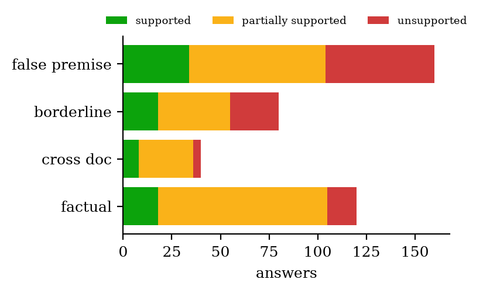</p>

### 9.3 Per category (out-of-fold AUROC)

| Category | EpistemeGraph v4 | 13 answer features | text NLI checker | LLM confidence | length | matched |
|---|---|---|---|---|---|---|
| Factual | 0.695 | 0.745 | 0.642 | **0.759** | 0.680 | 104 / 120 |
| Cross-paper | 0.539 | 0.664 | 0.602 | 0.219 | 0.703 | 33 / 40 |
| Unanswerable | 0.685 | 0.703 | 0.714 | **0.341** | 0.752 | 63 / 80 |
| False premise | **0.776** | 0.754 | 0.757 | 0.709 | 0.532 | 130 / 160 |

### 9.4 Tournament (nested CV on the training split, out-of-fold)

| Model | Log-loss ↓ | AUROC | Brier |
|---|---|---|---|
| **MonotoneHistGBM** ★ | **0.373** | 0.809 | 0.117 |
| GradientBoosting | 0.376 | 0.807 | 0.116 |
| StackingEnsemble | 0.388 | 0.774 | 0.117 |
| RandomForest | 0.397 | 0.768 | 0.121 |
| RBF-SVM | 0.405 | 0.767 | 0.124 |
| ExtraTrees | 0.416 | 0.756 | 0.129 |
| LogisticRegression | 0.418 | 0.720 | 0.127 |
| AttentionMIL | 0.495 | 0.562 | 0.149 |
| MLP | 0.573 | 0.438 | 0.189 |
| AttentionResNet | 0.621 | 0.632 | 0.209 |

With 262 training answers, boosted trees win and the neural contenders over-fit.

### 9.5 What the champion uses

Grouped permutation importance (increase in test log-loss): answer features: **LLM confidence 0.031**, **curvature
shift Δκ 0.016**, NLI consistency 0.008. Claim groups: NLI contradiction 0.010, NLI entailment 0.008, out-of-corpus
rate 0.005, **grafted-edge curvature 0.005**, provenance 0.004.

<p align="center">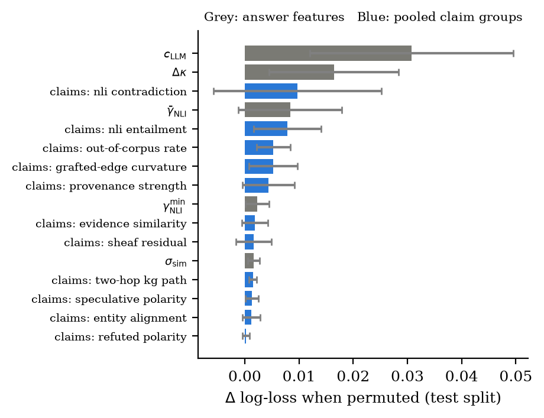</p>

Learned standardised weights of the interpretable logistic surrogate: sheaf energy +0.37, entity alignment +0.34,
worst-claim NLI +0.31, provenance +0.25, contradiction rate +0.24, LLM confidence +0.21, evidence similarity −0.21,
curvature shift −0.19, NLI mean −0.16, novelty +0.17, spectral divergence −0.10.

### 9.6 Calibration and conformal decisions

<p align="center">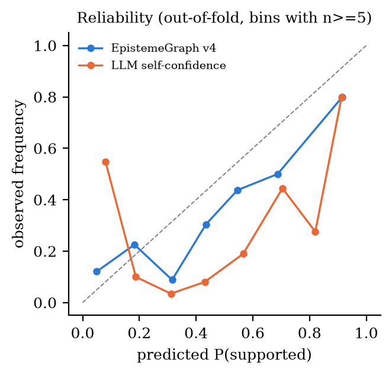 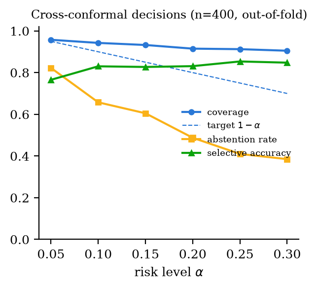</p>

| α | Coverage | Abstain | Accuracy on committed |
|---|---|---|---|
| 0.05 | 95.8% | 82.3% | 76.5% |
| **0.10** | **94.2%** | **65.8%** | **83.0%** |
| 0.15 | 93.2% | 60.5% | 82.7% |
| 0.20 | 91.5% | 48.7% | 83.1% |
| 0.25 | 91.2% | 41.0% | 85.4% |
| 0.30 | 90.5% | 38.5% | 84.8% |

Out-of-fold probabilities: ECE 0.090 (the LLM's confidence: 0.342). The reliability pool kept the KG term by both
checks (LRT p = 0.040; CV log-loss 0.4494 vs 0.4506) but with a **negative** weight ($`b_2=-1.23`$): answers that touch
well-grounded KG regions are less often fully supported, which we read as the verbosity confound again.

### 9.7 Held-out test split (pre-specified, n = 73)

| | v3 (13 inputs, split calibration) | **v4 (final)** |
|---|---|---|
| Champion | RandomForest | MonotoneHistGBM |
| AUROC $`S_{\text{query}}`$ / $`S_{\text{final}}`$ | 0.707 / 0.671 | **0.746 / 0.728** [0.562, 0.870] |
| Log-loss / ECE | 0.485 / 0.076 | **0.402 / 0.054** |
| Conformal coverage (α = 0.10) | 0.781 (below target) | **0.973** |
| Accuracy on committed decisions | 0.652 | **0.882** |

The test split holds only 13 supported answers, so its intervals are wide, and on it the LLM's confidence happens
to rank well (0.797) although over all 400 answers it is 0.591. That is why the repeated CV is the primary evidence.

## 10. Reading the numbers honestly

**Why not "97 out of 100" any more?** In the very first version (v1) the "expected" label of each hand-written
question was assigned **by its category** (every factual question was assumed VERIFIED, every trap question
HALLUCINATED), and the model was trained on synthetic data. The system was rewarded for recognising the *type of
question*, not for checking the *answer*, so 97/100 measured nothing real. From v2 on, every label comes from a judge
that reads the actual answer against the gold evidence, which is the honest task.

**Why 350/400 is not a meaningful target with these labels.**

1. *Imbalance:* 322 of 400 answers are not fully supported, so a constant "hallucinated" already scores 322/400. Raw
   accuracy hides almost everything; AUROC and balanced accuracy do not.
2. *Label noise sets a ceiling:* two strong LLM judges agree on **87.3%** of binary labels over all 400 answers, and a
   judge from another family disagrees far more. Where the two Claude judges agree (349 answers), the detector matches
   **305 (87.4%)**, i.e. it agrees with clean labels as often as the judges agree with each other.
3. *What does help:* `ABSTAIN`. On the 137 answers where it commits at α = 0.10, it is right on 114 (83%); at α = 0.25
   it commits on 59% of answers and is right on 85%.

**What would genuinely raise the numbers:** human or adjudicated labels (the single biggest lever), more questions per
category, a larger corpus (denser KG, higher recall) and a second audited model.

**A failure case worth knowing.** Asked "Assume node2vec uses genetic algorithms … detail its fitness function", Claude
Haiku **correctly rejected the premise**, yet the auditor reported P(hallucination) 85% and abstained, because 8 of the
answer's 9 claims about what node2vec really does found no matching edge in the 375-triple KG. KG recall is the main
weakness of graph-based checking on a small corpus.

## 11. How the project evolved (v1 → v4)

| Version | What it did | What was wrong / what changed |
|---|---|---|
| **v1** | 8-D feature vector, Boltzmann weights, fixed thresholds (0.6 / 0.28), fixed pool 0.2·S_KG + 0.8·S_query, 9-model tournament | trained on synthetic data; labels were category priors; Neo4j was wiped on upload; "AUROC 0.993" is invalid |
| **v2–v3** | 13 answer features + 15-D claim vectors, NLI (SummaC), learned pool, Mondrian conformal, nested-CV tournament, corpus workspaces, LLM judge with gold evidence | honest labels, but only 65 calibration points; test split of 73 answers too small; coverage below target |
| **v4 (this release)** | pooled claim statistics, cross-fitting on 327 answers, LRT + CV-gated reliability pool, cross-conformal decisions consistent with the probability, 5×5 repeated CV, second judge, Sonnet labels, measured KG precision, spend cap, protected reference corpus | – |

Engineering along the way: Claude via the Anthropic API (Haiku 5.5 for answers, extraction and KG; Sonnet 5.5 as
judge), Anthropic batch judging at half price with resumable batch IDs, fail-fast handling of credit and key errors,
and a new website.

## 12. What is new, and what is not

The instruments are established: knowledge sheaves, Forman curvature, Laplacian spectra, NLI consistency,
multiple-instance learning, Deep Sets, log-linear pooling, survey estimation and conformal prediction. The
contributions are:

1. using them as **measurement instruments** for the agreement between an answer's claim graph and a **fallible,
   measured** reference graph, with graft-based quantities and their proven properties;
2. an **identifiability and testing argument** for how reference reliability may enter a decision;
3. a **fully learned, cross-fitted decision layer** whose verdicts carry a conformal guarantee and never contradict
   their probability;
4. a **label-audited evaluation**, including the negative results: the geometric family does not significantly beat a
   strong text-only checker on this corpus, and a richer claim-set representation helped with the first labels but not
   with the stronger ones.

## 13. Scripts reference

All steps are cached and resumable: nothing finished is paid for twice.

| Command | What it does | API cost |
|---|---|---|
| `python app.py` (or `start.bat`) | website + API on http://localhost:8000 | per audit ≈ $0.002 |
| `python scripts/build_kg.py` | Phase 1 for the active corpus's PDFs | ≈ $0.05 / 3 papers |
| `python scripts/generate_benchmark.py --n 400` | evidence-validated questions | ≈ $0.10 |
| `python scripts/run_benchmark.py` | answer → claims → judge (batch) → second judge → features → tournament → report → paper | ≈ $1–2 |
| `python scripts/run_benchmark.py --reuse-answers` | retrain and re-evaluate from cache | **$0** |
| `python scripts/analyze_results.py` | label audit, confounds, per category, matching, conformal curve, figures | $0 |
| `python scripts/audit_kg_precision.py --n 100` | measured KG precision with Wilson and model-assisted CIs | ≈ $0.02 |
| `python scripts/sensitivity_phase1.py` | robustness of every Phase-1 constant | $0 |
| `python scripts/showcase_queries.py Q001 Q085` | audit questions from `data/benchmark_100_queries.txt` into the History panel | ≈ $0.002 each |
| `python scripts/third_judge.py export` / `import <file> --model <name>` | batches for an external judge (e.g. Gemini with the PDFs) and its agreement | $0 |
| `python scripts/run_benchmark.py --export-annotation 100` / `--agreement <csv>` | human validation of the judge | $0 |
| `python scripts/export_paper_assets.py` | `paper/generated/*`, figures, **Overleaf zip** | $0 |
| `python scripts/cleanup.py` | lists removable files (`--apply` deletes) | $0 |

## 14. Data, artefacts and the paper

Everything lives in `final_model/workspaces/<corpus>/` and is reloaded by the website:

| File | Content |
|---|---|
| `kg_store.json`, `latest_chunks.json`, `kg_fidelity_state.json` | the graph, the chunks, $`S_{\mathrm{KG}}`$ |
| `kg_precision_audit.json`, `sensitivity_phase1.json` | measured precision, robustness |
| `benchmark/benchmark.jsonl` | the 400 questions with gold answers and evidence quotes |
| `benchmark/runs/latest/` | every answer, judge verdict (`judgements/`, earlier judge in `judgements_archive/`), second-judge verdict, feature vector and claim bag; `usage.json` |
| `benchmark/results.csv`, `results_analysis.json`, `judge_crosscheck.json` | per-answer results with out-of-fold scores; every number in this README |
| `benchmark/third_judge/` | paste-ready batches for an external judge |
| `labelled_features.csv`, `labelled_bags.jsonl` | training data |
| `production_model_metrics.json`, `model.pkl`, `test_predictions.csv`, `cv_predictions.csv` | the brain and its evidence |
| `brain_v3_backup/`, `brain_v4_haikulabels/` | earlier brains for before/after comparisons |
| `query_history.jsonl` | every single audit made on the website |

**The paper.** `paper/main.tex` (IEEE conference format, 64 references) contains no hand-typed number: every value is
a macro in `paper/generated/results.tex`, written by `scripts/export_paper_assets.py`. To compile, upload
**`paper/EpistemeGraph_overleaf.zip`** to Overleaf (*New Project → Upload Project*); it contains `main.tex`,
`references.bib`, `generated/` and `figures/`. A single `main.tex` alone will not compile.

## 15. Repository layout

```text
app.py                     FastAPI server: REST API + website, background jobs, protected reference corpus
start.bat                  double-click launcher (Windows)
web/                       website (index.html, css/, js/{app,intro,hero,signals,story,kg,charts,util}.js, vendor/)
kg_audit/components/       kg_builder · llm_interceptor · graph_retriever · truth_evaluator · nli · model_trainer · decision
kg_audit/utils/            llm (Claude/OpenAI routing, retries, spend cap) · api_errors · main_utils · workspace · jobs
scripts/                   build_kg · generate_benchmark · run_benchmark · run_batch · retrain · audit_kg_precision
                           sensitivity_phase1 · analyze_results · export_paper_assets · third_judge · showcase_queries
                           cleanup · _llm (cache + batch API)
final_model/workspaces/    one folder per corpus (section 14)
data/                      benchmark_100_queries.txt (hand-written questions)
paper/                     main.tex, references.bib, generated/, figures/, EpistemeGraph_overleaf.zip
docs/figures/              README figures and screenshots
```

## 16. Engineering, cost and reliability

* **Total study cost: $1.90.** Answering and extraction (Haiku 5.5), judging (Sonnet 5.5, half-price batch), the second
  judge and the KG audit. Every retraining and analysis afterwards cost $0.
* **Never pay twice:** every LLM call is cached by content hash; stages checkpoint and resume; an interrupted Anthropic
  batch is re-polled by its saved ID instead of being resubmitted.
* **Spending cap:** `EPISTEME_BUDGET_USD` refuses any call or batch that would exceed it, *before* it is sent; the footer
  of the website shows the running total.
* **Fail fast:** no credits, a bad key or an unknown model stop a run within seconds with a plain message; rate limits and
  overload are retried, honouring `Retry-After`; every failure is counted in `failures.json`.
* **Calm CPU:** API calls run in a small I/O pool; heavy stages run at below-normal priority with capped BLAS threads.
* **Secrets:** `.env` is git-ignored and never leaves your machine.

## 17. Housekeeping: what can be deleted

`python scripts/cleanup.py` lists everything that is safe to remove (about **210 MB**): the MLflow logs and per-run
folders of the v1/v2 prototypes, the invalid v1 brain and results, per-question debug output, superseded brains, old job
logs and Python caches. Nothing needed to reproduce a number or to run the website is touched. Add `--apply` to delete.

## 18. Limitations

* **Labels:** two Claude judges agree moderately (κ = 0.57 on all 400, 0.35 on the hard stratified sample) and a Gemini
  judge applies a much more lenient definition (κ = 0.17); human annotation of a stratified sample is the definitive
  check (`--export-annotation`).
* **Scope:** three papers, one audited model, closed-book answers, 400 labelled answers.
* **KG recall:** a true claim with no matching edge looks unsupported to the graph features (see the failure case in
  section 10); the geometric features help the champion but do not significantly beat a text-only NLI checker here.
* **Guarantees** assume exchangeability between calibration and use; a new corpus or audited model needs its own
  benchmark. Cross-conformal calibration has a worst-case bound of $1-2\alpha$ (empirically ≥ 90% at α = 0.10).

## 19. Citation

```bibtex
@misc{The-Episteme-Graph,
  title  = {EpistemeGraph: Auditing LLM Answers Against a Measured Knowledge Graph with Geometric Claim Evidence
            and Cross-Conformal Decisions},
  author = {Raj, Anurag},
  year   = {2026},
  howpublished = {\url{https://github.com/Virtuoso-8051/EpistemeGraph}},
  note   = {Manuscript in preparation}
}
```
